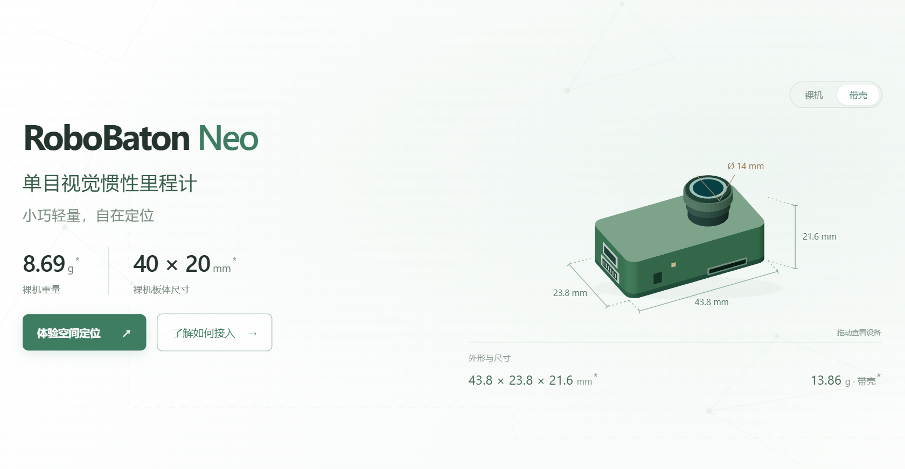

# RoboBaton Neo

**单目视觉惯性里程计 · 小巧轻量，自在定位**

[产品介绍](https://hessian-matrix.github.io/RoboBaton_Neo_docs/) · [快速开始](https://hessian-matrix.github.io/RoboBaton_Neo_docs/quick-start.html) · [文档中心](https://hessian-matrix.github.io/RoboBaton_Neo_docs/docs/) · [网页运行验证](https://hessian-matrix.github.io/RoboBaton_Neo_docs/integration.html)

将相机与 IMU 的运动信息融合为位置、姿态和速度，为无人机、移动机器人及手持采集设备提供视觉惯性里程计输入。通过 USB 网络访问设备页面，也可通过串口将里程计接入你的程序。

| 轻量集成 | 浏览器操作 | 开发接入 |
| :--- | :--- | :--- |
| 裸机 **8.69 g**，板体 **40 × 20 mm** | 设备连接、定位查看与标定引导 | USB HTTP API、串口 MAVLink 2 |
| 带壳 **13.86 g** | 图像、轨迹及设备设置 | JavaScript 网页验证、Python / Node.js 示例 |

尺寸与重量依据现有产品资料；模型为外观示意。接口能力及验证范围以[当前版本说明](https://hessian-matrix.github.io/RoboBaton_Neo_docs/docs/scope.html)为准。

## 从连接到结果

**① 连接设备** → **② 启动并初始化 VIO** → **③ 查看轨迹或接收数据**

| 你想做什么 | 从这里开始 |
| :--- | :--- |
| 第一次使用 Neo | [快速开始：连接、初始化与轨迹](https://hessian-matrix.github.io/RoboBaton_Neo_docs/quick-start.html) |
| 在网页直接运行接收代码 | [接入你的程序](https://hessian-matrix.github.io/RoboBaton_Neo_docs/integration.html) |
| 安装到机器人或飞行平台 | [安装位置与坐标设置](https://hessian-matrix.github.io/RoboBaton_Neo_docs/robot-mounting.html) |
| 完成相机与 IMU 标定 | [标定操作引导](https://hessian-matrix.github.io/RoboBaton_Neo_docs/calibration-guide.html) |
| 查询接口、录制、图像或排障 | [完整文档与搜索](https://hessian-matrix.github.io/RoboBaton_Neo_docs/docs/) |

## 不安装开发环境，先验证数据

在电脑 **Chrome / Edge** 打开[接入页面](https://hessian-matrix.github.io/RoboBaton_Neo_docs/integration.html)，选择 **串口 → JavaScript · 网页直接运行 → 连接并运行**，再选择 USB 转 TTL 模块。收到有效数据后，页面直接显示 **X / Y / Z 坐标与原始字段**，并可展开查看运行代码。

- 按[接线说明](https://hessian-matrix.github.io/RoboBaton_Neo_docs/docs/serial-pose.html)连接模块、共地和独立供电；波特率与设备一致。
- 先在设备页面启动 VIO 并完成初始化。网页验证只接收数据，不修改设备配置。
- 每次最多运行 60 秒，可随时停止；没有有效数据时保持空状态。

**Python 也能在线运行**：选择“Python · 网页直接运行”，先加载 Python，再连接设备。页面使用浏览器内的 Pyodide 执行展示的 Python 代码，并显示实际输出；首次需联网下载运行环境，设备数据不上传到云端。

**USB 位姿和图像也能在网页验证**：Windows x64 打开[免安装连接工具](https://hessian-matrix.github.io/RoboBaton_Neo_docs/NeoConnect-Windows-x64.exe)，网页选择 USB → 电脑连接工具，填写设备地址后运行。无需修改板端设置；工具只做本机只读转发，Python 仍在浏览器执行。首次连接请允许浏览器访问本地网络。

已用现有板卡验证真实位姿输出和 **544 × 640 灰度 JPEG**。Windows 包未签名，提供 [SHA256](https://hessian-matrix.github.io/RoboBaton_Neo_docs/NeoConnect-SHA256.txt) 和[源码/使用说明](connector/README.md)。需要本机集成时，可使用 [Python / Node.js 示例](https://hessian-matrix.github.io/RoboBaton_Neo_docs/docs/api-examples.html)。

## 关于这个仓库

文档中的“Neo 网页的使用”采用 **60 段约 9 秒的短视频**，逐项介绍真实网页的操作入口，配三步文字、中文字幕、结果确认和注意事项。支持步骤跳转、原生全屏和手机浏览；演示使用本机模拟数据，不会操作你的设备。

这里维护 **产品网站与用户文档**。产品页保留可旋转的设备模型、空间定位演示及交互式教程；文档提供目录、搜索和返回产品站的入口。

| 目录 | 内容 |
| :--- | :--- |
| [`site/`](site/) | 产品页面、交互教程与公开接收示例 |
| [`source/`](source/) | Sphinx 文档、接口快照与主题资源 |
| [`tools/`](tools/) | 构建、资源版本和回归检查 |
| [`site-manifest.json`](site-manifest.json) | 产品站发布资源清单 |

推送到 `master` 后，GitHub Actions 自动构建、检查并将网站与文档一同发布到 **GitHub Pages**。当前文档入口为本站 `/docs/`；旧 Read the Docs 地址不随此流程更新。

构建命令、页面维护和测试方法见 **[开发与维护指南](DEVELOPMENT.md)**。

程序接入精简为选择连接、配置接收、运行与结果三步；结果检查和排障合并到第三步，不再单独切页。

接入引导在不同连接方式、语言和数据选项间保持卡片、标题和操作栏位置一致；网页串口模式在相同字段位置提示运行时选择设备。

快速开始保留轨迹、程序接入、机器人安装三章；标定移至页尾文档入口。带壳尺寸按 C V3.9 STL 零件包围盒展示，支持上下壳模型原文件下载。
