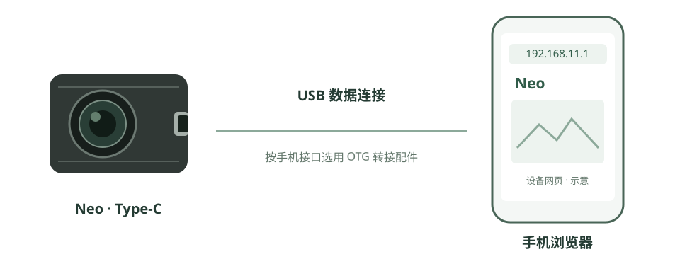

接入手机
========

通过 USB 连接 Neo，在手机浏览器中查看图像和位姿。手机需支持 USB OTG／主机模式及对应的 USB 网络设备。

   连接示意：Neo → USB 数据线／OTG 转接配件 → 手机浏览器

目前已在鸿蒙系统和苹果系统的测试设备上验证可用；部分安卓系统不支持该 USB 网络连接方式。

连接步骤
--------

.. container:: computer-step

   .. rubric:: 01 · 准备连接配件

   准备支持数据传输的 USB 线，按手机接口选用 OTG 转接头或支持主机模式的连接线。
   手机还需支持 Neo 使用的 USB 网络设备；具体型号和系统支持见下方说明。

.. container:: computer-step

   .. rubric:: 02 · 连接并识别 USB 网络

   将 Neo 的 Type-C 接口连接到手机，确认设备供电稳定，并在手机网络设置中查看新增的 USB 网络接口。
   如有 OTG 开关，先开启；如可配置该网络的 IPv4，选择自动获取地址。

.. raw:: html

   

鸿蒙 / 苹果 / 安卓：兼容性与连接配件

* **鸿蒙系统**：已在测试设备上验证可用，仍需开启 OTG／主机模式并使用支持数据传输的配件。
* **苹果系统**：已在测试设备上验证可用，需使用匹配机型接口的转接配件。
* **安卓系统**：部分系统不支持 Neo 所需的 USB 网络连接，不能仅凭支持 OTG 就判断可用。
* **供电**：手机或配件需满足 Neo 的供电要求。若使用有源 Hub 或独立供电方案，接线与电压要求见 :doc:`installation`。

.. raw:: html

   

.. container:: computer-step

   .. rubric:: 03 · 打开设备网页

   在浏览器 **地址栏** 输入 ``http://192.168.11.1/``。
   如果修改过设备网络地址，使用修改后的实际地址。

.. container:: computer-success

   **连接成功的判断**：能打开 Neo 设备网页，并看到图像持续更新。查看位姿前还需启动并初始化 VIO。

遇到问题再展开
--------------

.. raw:: html

   

没有识别 USB 网络、网页打不开或连接不稳定

.. list-table:: 按现象检查
   :header-rows: 1
   :widths: 30 70

   * - 现象
     - 先检查什么
   * - 没有 USB 网络接口
     - 确认手机主机模式、USB 网络驱动与线材支持；先按 :doc:`connect-computer` 用电脑验证 Neo 和线材。
   * - 已识别，网页打不开
     - 检查 USB 网络地址、设备实际地址与路由；如使用 VPN 或其他网络，可暂时断开后重试。
   * - 连接反复断开
     - 检查供电能力、OTG 转接头与线材，避免接头松动；供电方式见 :doc:`installation`。
   * - 网页打开，画面不更新
     - 检查设备连接状态、图像开关与浏览器解码支持，见 :doc:`imaging`。

.. raw:: html

   

.. container:: doc-next

   连接成功后：进入 :doc:`web-guide`；需要电脑连接时查看 :doc:`connect-computer`。

.. container:: product-footnote

   \* 能访问公网产品站不代表已经连接 Neo；网页权限不能补齐手机缺少的 USB 网络驱动。

   \* USB 网络不提供互联网。出现“无互联网”提示时，仍可用设备地址访问 Neo。
