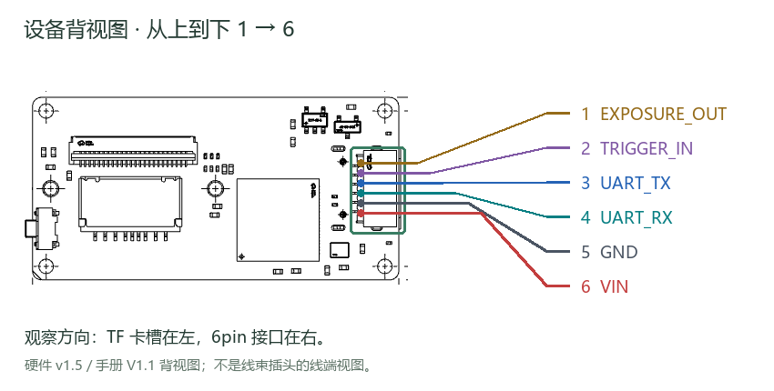
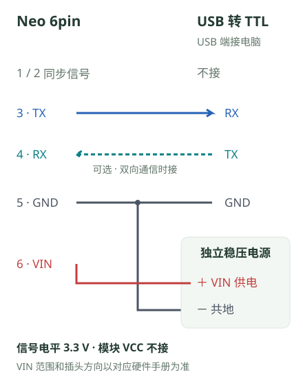

串口接线
========

通过串口将 Neo 位姿发送给电脑或飞控。接电脑需准备 **3.3 V USB 转 TTL 模块**，并为 Neo 单独确认供电。

先认针号，再接线
----------------

   设备背视图：TF 卡槽在左，6pin 在右，从上到下为 1～6。

**1 号在接口上端，6 号在下端**，观察方向与上图一致。这是设备端背视图，不是线束插头的线端视图；翻到另一面观察时，不要直接照搬左右位置。

   电脑接线示意 · 按端子编号展开，不代表插头朝向

两图颜色对应：TX 蓝色、RX 青色虚线（可选）、GND 深灰、VIN 红色；线色仅用于区分信号，不代表实际线束颜色。

**先核对电平与供电**：串口信号为 3.3 V LVTTL，不能直接接 RS-232 或 5 V 串口。
下图采用独立稳压电源，模块 VCC 不接 Neo；VIN 电压与极性须按实际硬件版本核对。

连接步骤
--------

.. container:: computer-step

   .. rubric:: 01 · 断电，核对端子

   断开 Neo、模块和外部电源，按对应硬件手册找到 TX、RX、GND、VIN。
   将 USB 转 TTL 模块的 **信号电平** 设为 3.3 V；不要仅凭模块 VCC 标注判断信号电平。

.. container:: computer-step

   .. rubric:: 02 · 接信号线与电源

   **Neo TX → 模块 RX**，两端 **GND 共地**。只接收位姿时，Neo RX 可以不接；需要双向通信时，再接 **模块 TX → Neo RX**。

   本图使用独立供电：电源正极接 Neo VIN，负极接 Neo GND，并与模块 GND 相连。
   模块 VCC 留空，1、2 号同步信号脚不接。

.. raw:: html

   

展开 6pin 针号与电压说明

.. list-table:: 当前产品接口说明中的端子定义
   :header-rows: 1
   :widths: 12 35 53

   * - 针号
     - 信号
     - 本图接法
   * - 1
     - EXPOSURE_OUT
     - 不接
   * - 2
     - TRIGGER_IN
     - 不接
   * - 3
     - UART_TX
     - 接模块 RX
   * - 4
     - UART_RX
     - 可选接模块 TX
   * - 5
     - GND
     - 接模块 GND 和电源负极
   * - 6
     - VIN
     - 接匹配硬件规格的稳压电源正极

硬件 v1.5 对应产品手册 V1.1 标注 VIN 为 3.3–5 V，UART 信号为 3.3 V LVTTL，同步信号为 1.8 V。
供电电压与信号电平是不同参数，不能混用；同步信号脚不能作为 UART 使用。
实体插头的观察方向与针号以对应硬件手册为准，不从图中左右位置推断。

.. raw:: html

   

.. container:: computer-step

   .. rubric:: 03 · 上电并确认串口

   检查电压、极性和接线后给 Neo 上电，将模块 USB 端连接电脑，确认系统出现对应串口。
   随后按 :doc:`serial-pose` 设置接收参数并读取位姿；飞控接入见 :doc:`mounting-flight-controller`。

.. container:: computer-success

   **接线检查完成**：Neo 供电稳定，电脑识别到模块串口。位姿是否可用，还需以 VIO 初始化完成并持续收到有效数据为准。

遇到问题再展开
--------------

.. raw:: html

   

没有串口、没有数据或连接不稳定

.. list-table:: 按现象检查
   :header-rows: 1
   :widths: 30 70

   * - 现象
     - 先检查什么
   * - 电脑没有新增串口
     - 核对模块 USB 连接与模块驱动；是否需要安装驱动取决于模块型号和操作系统，不是 Neo USB 网卡驱动。
   * - 有串口，但没有位姿
     - 检查 Neo TX → 模块 RX、共地和双方波特率；确认 VIO 已启动并完成初始化，见 :doc:`serial-pose`。
   * - 数据异常或断续
     - 核对串口参数、供电、线缆与接头；MAVLink 是二进制协议，普通串口助手显示乱码不等于接线错误。
   * - 要连接飞控
     - 按飞控端口标注交叉连接 TX/RX 并共地，核对供电脚电压；后续配置见 :doc:`mounting-flight-controller`。

.. raw:: html

   

.. container:: doc-next

   接线完成后：:doc:`serial-pose`；接入飞控：:doc:`mounting-flight-controller`。

.. container:: product-footnote

   \* 本页示意采用独立供电，不将 USB 转 TTL 模块的未知 VCC 接到 Neo。其他供电方式见 :doc:`installation`。

   \* 串口用于位姿数据；图像通过 USB 网络读取，见 :doc:`api-examples`。
