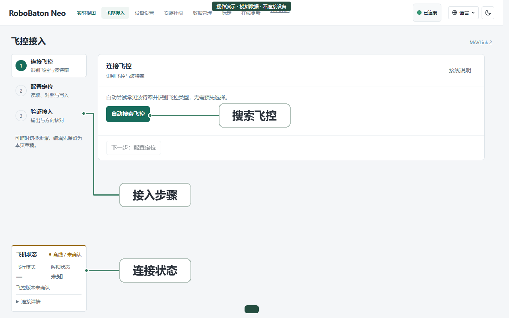

飞控接入页面
========================

   点击图片查看分区标注

.. web-tutorials:: flight
   :title: 功能演示
   :no-intro:
   :compact:

.. container:: doc-next

   返回 :doc:`web-guide` 查找其他操作；接口字段与程序接入见 :doc:`api-reference`。

.. container:: product-footnote

   \* 截图与视频为演示数据。

MAVLink 控制 VIO
----------------

COMMAND_LONG 使用自定义命令 MAV_CMD_USER_1=31010。
param1 为 0 停止、1 启动、2 重启；param2 为 1..65535 的请求编号；param3..7 为 0。
必须指向 Neo 的准确系统和组件，默认组件为 197，不接收广播控制。
ACK 的 result_param2=(request_id<<8)|reason；IN_PROGRESS 后等待最终结果。
响应丢失先查询实际状态，避免盲目重复重启。

GET/POST /api/mavlink/vio/config 查询或保存遥控通道；rc_channel 为 1..18 或 null（禁用）。
写入须携带 UUID Idempotency-Key，保存后立即生效。状态中的 vio_control 和心跳反映 VIO 状态。
拨杆低位不高于 1300、高位不低于 1700，稳定 300 ms 后停止或启动。
首次接收及重连只建立基准，不立即触发；拨杆不执行重启，也不是失控保护功能。
默认禁用。串口直连验证不等于真实飞控转发或遥控拨杆验收。
