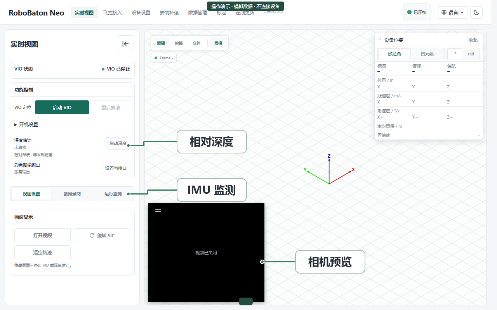

图像、IMU 与深度
========================

   点击图片查看分区标注

.. web-tutorials:: imaging
   :title: 功能演示
   :no-intro:

.. container:: doc-next

   返回 :doc:`web-guide` 查找其他操作；接口字段与程序接入见 :doc:`api-reference`。

.. container:: product-footnote

   \* 截图与视频为演示数据。

图像并发与帧率
--------------

GET/POST /api/gray/config 支持原始灰度 5 fps（默认）和 30 fps。
30 fps 与全分辨率彩色、gray_jpeg、TF 图像录制互斥；可以和独立预览共存。
原始灰度 30 fps 与深度并用时，VIO 必须关闭；标定采集保持 5 fps。
图像通道只允许一个 HTTP 订阅，冲突时后来的请求被拒绝。

彩色可选 60、30、20、15、12、10、6、5、4、3、2、1 fps。
VIO 关闭时最高 60 fps，开启时最高 30 fps。
VIO 开启且并用深度、原始灰度、gray_jpeg 或 TF 图像录制时最高 5 fps。
具体可选值以 available_fps 为准，不能仅根据 fps_max 推断所有整数帧率都可用。

独立预览本身不降低彩色可选帧率。高于 5 fps 的彩色开始实际出帧后会关闭原有独立预览；
新的独立预览请求返回 409 IMAGE_CONFLICT，页面可使用彩色解码画面。
仅查询或设置配置、打开失败不会关闭预览；彩色不高于 5 fps 时可与预览共存。
原始灰度 30 fps 与全分辨率彩色始终互斥，TF 彩色录制会锁定整组编码配置。
页面默认开启预览，与 VIO 启停独立；手动关闭在切换标签时保留，刷新后重新开启。
