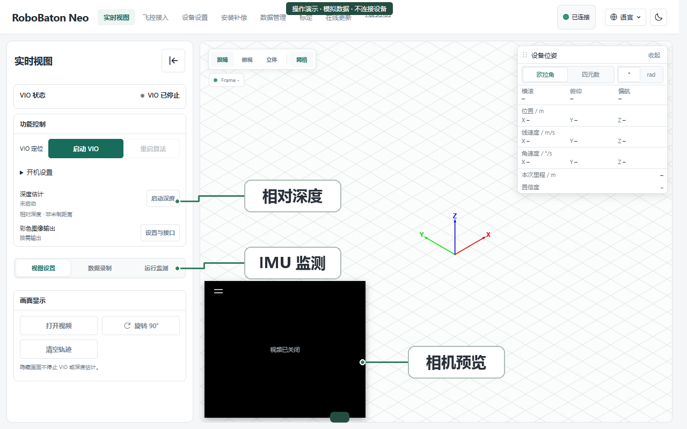

图像、IMU 与深度
========================

   点击图片查看分区标注

.. web-tutorials:: imaging
   :title: 功能演示
   :no-intro:

.. container:: doc-next

   返回 :doc:`web-guide` 查找其他操作；接口字段与程序接入见 :doc:`api-reference`。

.. container:: product-footnote

   \* 截图与视频为演示数据。
