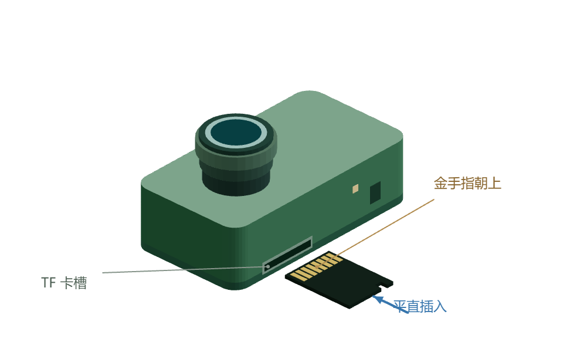

插入与准备 TF 卡
================

TF 卡（microSD）用于设备侧录制。第一次查看图像和轨迹不必插卡。

   产品介绍同源模型：金手指朝上，触点端先进入卡槽。

**先停止录制并等待收尾完成，再断电插卡。** 按图中设备摆放方向，让 TF 卡金手指朝上、触点端先进入卡槽，不强行插入。

准备与确认
----------

.. container:: computer-step

   .. rubric:: 01 · 找到卡槽，断电插卡

   找到机身长侧面的 TF 卡槽，让 **金手指朝上**，将触点端对准卡槽，沿蓝色箭头方向平直插入。遇到明显阻力时停止，重新核对方向，避免斜插或用力顶压。

.. container:: computer-step

   .. rubric:: 02 · 上电，查看卡状态

   连接电源，打开设备网页的 **数据管理** 页面，等待系统检查并挂载 TF 卡。
   状态为 **ready** 后，再检查剩余空间。

.. container:: computer-step

   .. rubric:: 03 · 检测通过后再录制

   执行页面提供的录制检测，按所选数据源确认可用，再开始录制。
   具体录制、下载与导出操作见 :doc:`recording`。

.. container:: computer-success

   **准备完成的判断**：卡状态为 ready、剩余空间满足本次录制需求，且所选数据源的录制检测通过。

遇到问题再展开
--------------

.. raw:: html

   

支持哪些格式？已有数据怎么处理？

配套系统支持 **FAT32 与 exFAT**，使用唯一 SD 卡的单一第一分区或无分区表文件系统。
多分区、未知格式或检查失败时，不会自动格式化或强行写入。

**已有数据先备份。** 不能将“未挂载”直接理解为需要格式化；先核对卡状态、接触情况与文件系统。

.. raw:: html

   

   

missing / unmounted / ready 分别表示什么？

.. list-table:: 按状态检查
   :header-rows: 1
   :widths: 23 35 42

   * - 状态
     - 含义
     - 下一步
   * - missing
     - 未检测到卡
     - 停止任务并断电后，核对插入方向与接触情况。
   * - unmounted
     - 检测到设备，尚未挂载
     - 等待系统检查；若仍未挂载，核对文件系统与分区，不直接格式化。
   * - ready
     - 已挂载且可写
     - 检查剩余空间，并完成录制检测。

.. raw:: html

   

安全取卡
--------

停止录制，等待收尾完成，确认没有写卡任务后断电，再取出卡片。**不要在录制或写入时拔卡。**

.. container:: doc-next

   准备完成后：进入 :doc:`recording`，学习录制、下载与导出。

.. container:: product-footnote

   \* “朝上”以图中的设备摆放方向为参照，不随设备实际安装姿态改变；其他硬件版本的卡槽结构与锁定方式以对应实物为准。
