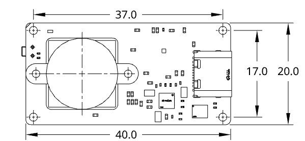
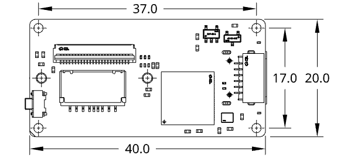
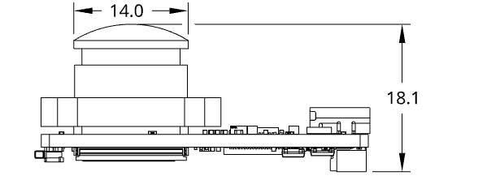

设备安装与供电
==============

结构与尺寸
----------

裸板尺寸
~~~~~~~~

.. list-table:: 尺寸参数（mm）
   :header-rows: 1
   :widths: 40 30 30

   * - 项目
     - 裸板
     - 带壳整机
   * - 长 × 宽
     - 40 × 20
     - 43.8 × 23.8
   * - 含镜头总高
     - 19.5
     - 21.6
   * - 镜头最大外径
     - 14
     - 镜头与视野需留空

   正面 · 板体与安装孔位（点击查看原图）

   背面 · 器件与接口布局（点击查看原图）

   侧视 · 原图高度标注 18.1 mm；安装总高按产品参数 19.5 mm 预留。

带壳结构与模型
~~~~~~~~~~~~~~

带壳整机外形为 **43.8 × 23.8 × 21.6 mm**。外壳由上壳和底壳组成，镜头、USB、串口与 TF 卡开口按实物版本核对。

.. container:: installation-shells

   .. figure:: _static/manual/neo-shell-upper.png
      :alt: Neo上壳内部结构，展示镜头开口、接口开口及固定位置

      上壳

   .. figure:: _static/manual/neo-shell-bottom.png
      :alt: Neo底壳内部结构，展示支撑与固定位置

      底壳

.. list-table:: 外壳零件网格包围盒（mm）
   :header-rows: 1
   :widths: 30 40 30

   * - 零件
     - 长 × 宽 × 高
     - 模型文件
   * - 上壳
     - 43.8 × 23.8 × 10.89
     - `上壳 STL <../upper_C_V3.9_top_down_mm.stl>`_
   * - 底壳
     - 43.8 × 23.8 × 5.10
     - `底壳 STL <../bottom_C_V3.9_mm.stl>`_

.. container:: product-footnote

   \* STL 单位为 mm；零件高度含装配搭接，不能相加作为整机总高。安装孔、公差与最终装配以对应版本图纸核对。

接口位置
~~~~~~~~

* **USB Type-C**：传输数据并供电，连接电脑或兼容手机。
* **6pin**：串口、地、电源及同步信号，针号与逐线接法见 :doc:`connect-serial`。
* **TF 卡槽**：用于设备侧录制，首次查看画面和轨迹不必插卡。
* **镜头**：安装后保持无遮挡，并为线缆插拔和弯曲预留空间。

连接总览
--------

按使用目标选择连接方式，点击卡片进入对应页面。

.. raw:: html

   

     

       
       <strong>Neo</strong>
     

     

       

         
<strong>USB Type-C</strong>数据与供电浏览器打开设备网页

         →
         

           <a href='connect-computer.html'><strong>电脑 · USB 直连</strong>查看图像、轨迹，进行配置与标定准备：支持数据传输的 Type-C 线<b>接入电脑 →</b></a>
           <a href='connect-phone.html'><strong>手机 · OTG 连接</strong>用手机浏览器查看和操作设备要求：OTG、USB 网络与足够供电<b>接入手机 →</b></a>
         

       

       

         
<strong>3.3 V 串口</strong>MAVLink 位姿数据需另行确认设备供电

         →
         

           <a href='connect-serial.html'><strong>电脑 · 串口接收</strong>由自己的程序接收位姿数据准备：3.3 V USB 转 TTL 模块<b>串口接线 →</b></a>
           <a href='mounting-flight-controller.html'><strong>飞控 · 外部定位</strong>把 Neo 位姿接入飞控定位融合要求：匹配的串口、电平与供电<b>接入飞控 →</b></a>
         

       

     

   

固定到机器人后，安装位置与朝向的配置见 :doc:`mount-settings`；读取串口数据见 :doc:`serial-pose`。

选择供电方式
------------

.. list-table::
   :header-rows: 1
   :widths: 25 40 35

   * - 场景
     - 如何供电
     - 必须确认
   * - USB 接电脑
     - 由设备 Type-C 接口供电
     - 线材能传数据，连接稳定
   * - USB 接手机
     - 手机主机端或合适的外部供电方案
     - 手机供电能力和 OTG 模式
   * - 串口独立运行
     - 合适的稳压电源接 VIN/GND
     - VIN 电压、极性与共地

硬件 v1.5 对应资料中，6pin VIN 输入为 **3.3–5 V**，串口逻辑电平为 **3.3 V LVTTL**。
这是两个不同参数：允许 VIN 接 5 V 不代表 UART_RX 可以接 5 V 信号。
不要直接接 RS-232；不要把未知飞控电源脚或 TTL 模块 VCC 当作合适电源。

手册描述 USB 与 6pin 同时供电时优先 USB 并自动切换，但接线前仍应核对硬件版本。
首次测试优先使用一种明确、稳定的供电方式。没有核定供电电流数据时，不用猜测值作为电源选型保证。
