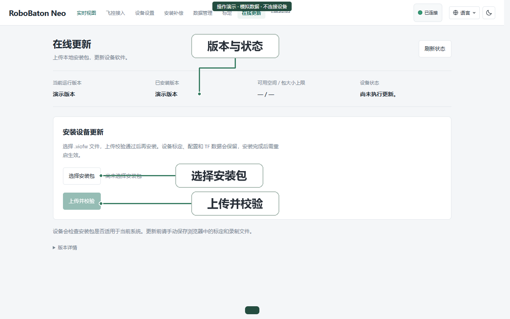

在线更新与重启
========================

固件下载
--------

当前最新版本为 V2.0.0（2026-11-26）。

* `下载最新固件 <https://hessian-matrix.github.io/RoboBaton_Neo_docs/firmware/latest/RoboBaton-Neo.viofw>`_
* `下载 SHA256 校验文件 <https://hessian-matrix.github.io/RoboBaton_Neo_docs/firmware/latest/RoboBaton-Neo.viofw.sha256>`_
* `V2.0.0 版本详情 <https://github.com/Hessian-matrix/RoboBaton_Neo_docs/releases/tag/v2.0.0>`_ · `全部历史版本 <https://github.com/Hessian-matrix/RoboBaton_Neo_docs/releases>`_

最新固件及校验文件使用固定链接，后续版本发布后无需更换网址。需要指定版本时，从历史版本页面下载。

V2.0.0
------

* 新增 MAVLink 串口和遥控拨杆控制 VIO。串口命令可启动、停止或重启 VIO；在网页选定遥控通道后，可用拨杆启动或停止 VIO。

* VIO 开启时，图像输出最高可达 30 fps。未压缩原始灰度新增 30 fps 档位，保留原有 5 fps；全分辨率彩色单独输出时，上限从 5 fps 提高到 30 fps。VIO 开启并同时使用深度、原始灰度、灰度 JPEG 或 TF 图像录制时，彩色上限为 5 fps。独立预览不降低彩色可选帧率；高于 5 fps 的彩色实际出帧后会关闭独立预览。

* 修复 TF 卡异常卸载后无法重新挂载的问题。未正常卸载的卡通过文件系统检查后可重新挂载；网页新增“重新检查”和“安全弹出”操作。

* 修复网页录制提前结束的问题，取消单次录制的 256 MiB 总量上限。

* 新增官方固件更新提醒。网页可检查新版本，经用户确认后下载安装包并上传至设备。

* 修复实体按键录制无响应的问题。

旧版网页若没有检查新版本的入口，请手动下载并上传更新包。下方截图和视频为较早版本演示，按钮名称与布局以当前设备为准。

下载后，在设备网页的更新页面选择 ``RoboBaton-Neo.viofw``，上传完成并通过检查后安装，按提示重启。
固件版本以设备识别的版本及发布说明为准；安装期间保持供电稳定。

   点击图片查看分区标注

.. web-tutorials:: update
   :title: 功能演示
   :no-intro:
   :compact:

.. container:: doc-next

   返回 :doc:`web-guide` 查找其他操作；接口字段与程序接入见 :doc:`api-reference`。

.. container:: product-footnote

   \* 截图与视频为演示数据。

更新状态与版本识别
------------------

GET /api/update 已删除 installed，客户端不要继续依赖该字段。
running 和 gateway_running 表示实际运行程序版本，package 表示候选包，两者不得互相代填。
安装但未重启时运行版本仍为旧版；新程序启动不等于 operation 已完成。
网页通过固定 firmware/latest.json 查询新版，用户确认后下载并上传更新包。
安装和重启仍需用户操作；稍后提醒按设备和版本延迟 24 小时。
