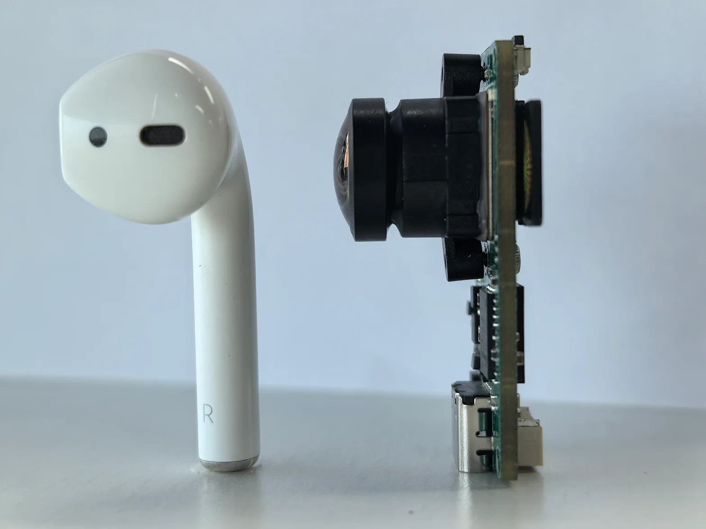
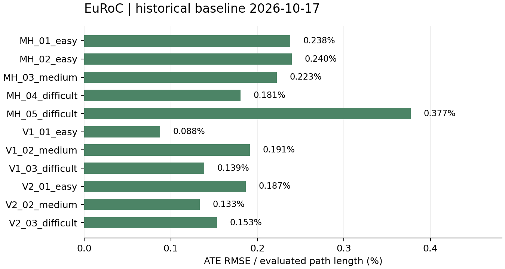
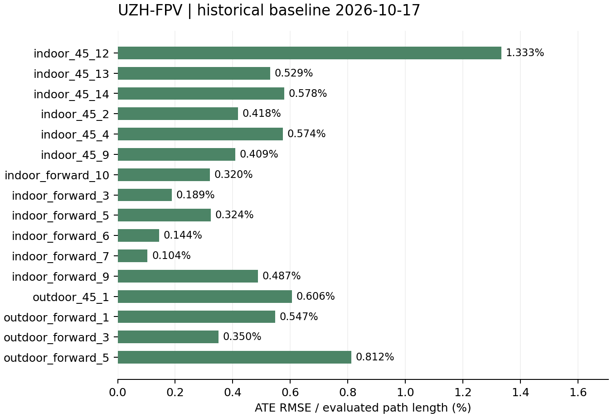

Neo 性能与参数
==============

.. container:: product-photos

   .. figure:: _static/manual/neo-bare-render.png
      :alt: Neo裸板STEP模型渲染图，展示镜头、板体与接口

   .. figure:: _static/manual/neo-enclosed-photo.webp
      :alt: Neo带壳实物照片，展示黑色外壳、镜头与侧面接口

.. container:: product-summary

   Neo 通过相机图像和惯性传感器（IMU）的数据，估计设备的 **位姿**。
   位姿包括位置（设备在哪里）和姿态（设备朝向哪里）。

硬件参数
--------

外形尺寸与重量
~~~~~~~~~~~~~~

提供裸板与带壳两种外观。裸板展示板体、镜头与接口；带壳整机保留镜头和接口开口。

.. list-table:: 裸机与带壳参数对照
   :header-rows: 1
   :widths: 32 34 34

   * - 项目
     - 裸机
     - 带壳
   * - 长 × 宽
     - 40 × 20 mm
     - 43.8 × 23.8 mm
   * - 总高，包含镜头
     - 19.5 mm
     - 21.6 mm
   * - 重量
     - 8.69 g
     - 13.86 g
   * - 镜头最大外径
     - 14 mm
     - 安装时为镜头和视野留出空间

   裸板与无线耳机实物对比

相机：分辨率、视场与快门
~~~~~~~~~~~~~~~~~~~~~~~~

.. list-table:: 相机规格与含义
   :header-rows: 1
   :widths: 28 27 45

   * - 参数
     - 产品规格
     - 如何理解
   * - 图像类型
     - RGB
     - 相机采集彩图；具体输出通道可以是彩图或灰度
   * - 快门
     - 全局快门
     - 减少逐行曝光造成的几何畸变，但仍可能运动模糊
   * - 分辨率
     - 1080 × 1280，宽 × 高
     - 不等于每个外发通道都使用该分辨率
   * - 最高采集帧率
     - 60 fps
     - 是相机采集能力，不是所有功能共载时的外发保证
   * - 对角视场角
     - 193.8°
     - 是对角视角，不能当作水平视角

惯性传感器与时间关联
~~~~~~~~~~~~~~~~~~~~

.. list-table:: 惯性相关参数
   :header-rows: 1
   :widths: 30 30 40

   * - 参数
     - 参考值
     - 数据来源与限制
   * - 默认输出频率
     - 约 200 Hz
     - 当前默认处理策略，实际频率由运行数据核对
   * - 陀螺仪噪声密度
     - 0.007 °/s/√Hz
     - 传感器资料典型值，非板级实测保证
   * - 陀螺仪零偏温漂
     - ±0.015 °/s/°C
     - 不是运行中零偏稳定性指标
   * - 相机—IMU 时间偏移
     - 所提供 Kalibr 结果小于 1 ms
     - 是该次标定结果，不是任意工况最大同步误差保证

连接、供电与存储
~~~~~~~~~~~~~~~~

.. list-table:: 接口与电气参数
   :header-rows: 1
   :widths: 28 72

   * - 项目
     - 参数与限制
   * - USB Type-C
     - 数据与供电，识别为 USB 网络；手机需支持 OTG、对应网络驱动并满足供电条件
   * - 6pin 定义
     - 手册 V1.1 / 硬件 v1.5：1 曝光同步、2 外部触发、3 TX、4 RX、5 GND、6 VIN
   * - 信号电平
     - UART 为 3.3 V LVTTL；同步信号为 1.8 V，不能混接或直接连接 RS-232
   * - VIN 输入
     - 上述版本为 3.3–5 V；与串口逻辑电平不同，接线前核对电压与极性
   * - 串口默认配置
     - 921600 bit/s、8N1、无流控；修改后以设备实际配置为准
   * - TF 卡
     - FAT32 / exFAT，单一第一分区或无分区表文件系统；录制前确认 ready 与剩余空间

供电检查见 :doc:`installation`；串口接线见 :doc:`connect-serial`。

定位性能
--------

.. list-table:: 历史基准汇总
   :header-rows: 1
   :widths: 25 15 30 30

   * - 数据集
     - 序列数
     - 平均归一化误差
     - 初始化延迟中位数
   * - EuRoC
     - 11
     - 0.195%
     - 1.75 s
   * - UZH-FPV
     - 16
     - 0.483%
     - 0.43 s

EuRoC
~~~~~

共 11 条序列，平均归一化误差 **0.195%**，初始化延迟中位数 **1.75 s**，范围 0.50–4.60 s。

.. raw:: html

   

查看 EuRoC 11 条序列明细

.. list-table:: EuRoC 逐序列结果
   :header-rows: 1
   :widths: 38 20 20 22

   * - 序列
     - ATE RMSE (m)
     - 误差 (%)
     - 初始化 (s)
   * - MH_01_easy
     - 0.191
     - 0.238
     - 1.80
   * - MH_02_easy
     - 0.175
     - 0.240
     - 1.75
   * - MH_03_medium
     - 0.291
     - 0.223
     - 4.00
   * - MH_04_difficult
     - 0.166
     - 0.181
     - 0.80
   * - MH_05_difficult
     - 0.368
     - 0.377
     - 0.55
   * - V1_01_easy
     - 0.051
     - 0.088
     - 2.40
   * - V1_02_medium
     - 0.145
     - 0.191
     - 0.50
   * - V1_03_difficult
     - 0.110
     - 0.139
     - 0.50
   * - V2_01_easy
     - 0.068
     - 0.187
     - 1.00
   * - V2_02_medium
     - 0.110
     - 0.133
     - 4.60
   * - V2_03_difficult
     - 0.132
     - 0.153
     - 2.20

.. raw:: html

   

UZH-FPV
~~~~~~~

共 16 条序列，平均归一化误差 **0.483%**，初始化延迟中位数 **0.43 s**，范围 0.43–3.35 s。

.. raw:: html

   

查看 UZH-FPV 16 条序列明细

.. list-table:: UZH-FPV 逐序列结果
   :header-rows: 1
   :widths: 38 20 20 22

   * - 序列
     - ATE RMSE (m)
     - 误差 (%)
     - 初始化 (s)
   * - indoor_45_12
     - 1.476
     - 1.333
     - 1.26
   * - indoor_45_13
     - 0.852
     - 0.529
     - 0.73
   * - indoor_45_14
     - 1.248
     - 0.578
     - 0.43
   * - indoor_45_2
     - 0.867
     - 0.418
     - 0.43
   * - indoor_45_4
     - 0.947
     - 0.574
     - 0.43
   * - indoor_45_9
     - 0.522
     - 0.409
     - 0.43
   * - indoor_forward_10
     - 0.416
     - 0.320
     - 0.43
   * - indoor_forward_3
     - 0.525
     - 0.189
     - 0.43
   * - indoor_forward_5
     - 0.172
     - 0.324
     - 1.26
   * - indoor_forward_6
     - 0.301
     - 0.144
     - 3.35
   * - indoor_forward_7
     - 0.327
     - 0.104
     - 0.43
   * - indoor_forward_9
     - 0.605
     - 0.487
     - 1.39
   * - outdoor_45_1
     - 0.795
     - 0.606
     - 0.43
   * - outdoor_forward_1
     - 1.259
     - 0.547
     - 0.43
   * - outdoor_forward_3
     - 2.367
     - 0.350
     - 0.43
   * - outdoor_forward_5
     - 1.141
     - 0.812
     - 0.43

.. raw:: html

   

`下载逐序列原始结果 JSON <_static/manual/benchmark-results.json>`_。

数据输出能力
------------

* **位姿与运动数据**：位置、姿态、速度。
* **传感器数据**：彩色图像、灰度图像及 IMU 数据。
* **接入方式**：USB 网络（HTTP）或串口（MAVLink）。

具体输出见 :doc:`imaging`；程序接入见 :doc:`api-guide` 和 :doc:`serial-pose`。

使用边界与下一步
----------------

* 输出相对起点的位置与姿态，不是 GPS 经纬度；重新启动后会建立新的定位参考。
* 需要可辨识的静态环境；弱光、纯色墙面、遮挡、强振动或大量移动物体会影响定位。
* 初始化完成且定位有效时再使用位姿；失跟时不能把旧数据当作当前位置。

.. container:: doc-next

   下一步：:doc:`installation` → :doc:`web-guide` → :doc:`api-examples`。

.. container:: product-footnote

   .. rubric:: 注释

   \* 尺寸与重量来自现有产品资料；安装需预留镜头视野与线缆空间，孔位及公差以机械图为准。图纸见 :doc:`installation`。

   \* 采集规格不等于外发速率。分辨率、裁剪或图像网格改变后，需匹配内参与畸变参数。

   \* IMU 默认约 200 Hz，为多样本平均、窗口中心时间戳，非全部 FIFO 原始样本；加速度含重力，未扣除 VIO 估计偏置。

   \* IMU 噪声密度为传感器典型值，条件为 10 Hz、25°C、VDD/VDDIO 1.8 V；零偏温漂条件为 −40°C 至 +85°C，非运行零偏稳定性或整机温度保证。小于 1 ms 为所提供 Kalibr 标定的时间偏移，非最大同步误差保证。

   \* 整机功耗、工作温度、手机兼容性及卡吞吐上限暂无统一保证值。

   \* HTTP 位姿以 IMU 原点为参考，串口应用安装补偿；安装配置按相机光心相对机器人参考点的位置与朝向填写，避免飞控重复补偿。

   \* USB 压缩图像 H.264/H.265/MJPEG 最高 60 fps 为手册规格，非所有分辨率、编码和共载组合的保证；MJPEG 60 fps 有偶发丢帧记录。H.265 依赖浏览器解码支持，多路订阅、录制、彩图及深度共享计算与带宽。

   \* HTTP 查询为 JSON，实时流为 RBH1 二进制封装；位姿与图像分路订阅，需按有效时间戳关联，顺序接收不等于同步配对。

   \* 性能数据来自 2026-10-17 历史算法基准 QR-plain-20261017-full（EuRoC 11 条、UZH-FPV 16 条），不是当前固件重新实测，亦非精度保证。图表由随页 JSON 生成，误差越小越好。

   \* 评估采用 SE(3) 对齐，不做尺度修正；归一化轨迹误差 = ATE RMSE / 评估区间真值路程 × 100%。均值按序列等权，非路程加权或逐段漂移率；初始化延迟为数据时间轴上首个位姿的延迟，非上电耗时。

   \* 评估仅覆盖真值匹配区间，完成序列不代表全程无失跟。EuRoC 最大速度 2.87 m/s、最大角速度 198.3 °/s 为数据集统计，非设备上限或峰值精度保证。

   \* 光照、纹理、振动、模糊、遮挡和动态物体会影响定位；更换镜头或相机与 IMU 的相对结构后需检查标定。

   \* Python 单文件 HTTP 示例已验证；ROS / ROS 2 为桥接方案，非已验收完整驱动。飞控需确认实际定位融合，不能只看心跳。
