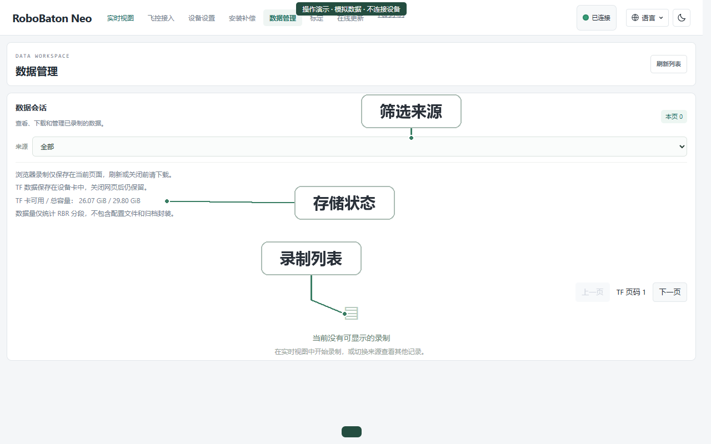

数据录制与管理
========================

   点击图片查看分区标注

.. web-tutorials:: recording
   :title: 功能演示
   :no-intro:
   :compact:

.. container:: doc-next

   返回 :doc:`web-guide` 查找其他操作；接口字段与程序接入见 :doc:`api-reference`。

.. container:: product-footnote

   \* 截图与视频为演示数据。

分段与自动分卷
----------------------------------------

TF 段约 256 MiB 或 10 分钟切换，H.264/H.265 等待随机访问帧最多 10 秒。
浏览器录制取消累计 256 MiB 上限，按约 256 MiB 或 10 分钟分为多个 ZIP；
视频等待上限约为 264 MiB 或 10 分 2 秒。每卷独立编号，同一会话共享 session_id。
结束原因为 volume_rollover 或 user_stop，与完整性分开判断；source_complete=null 表示未知。
下载包解析、CSV 和视频导出见 :doc:`recording-tools`。
