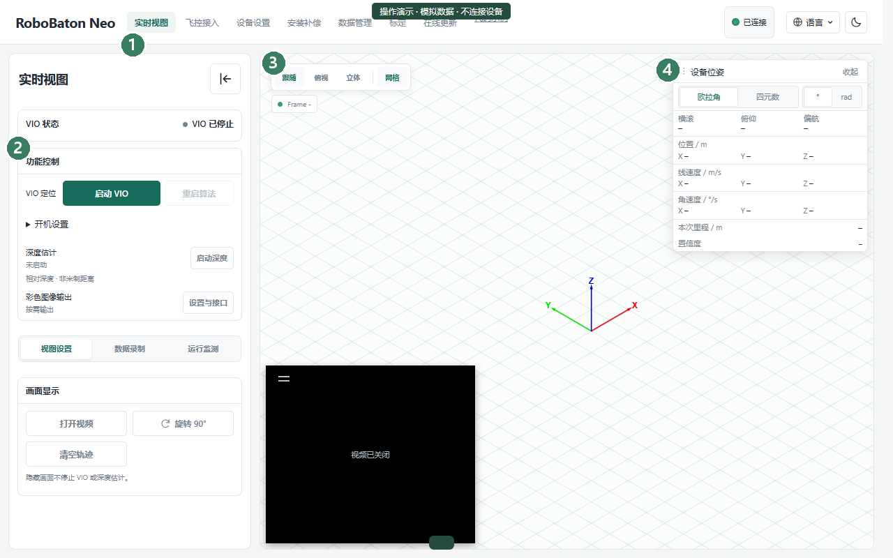

网页总览
========

1. 打开设备网页
---------------

连接 Neo 后，打开：

`http://192.168.11.1/ <http://192.168.11.1/>`_

如果修改过设备地址，请使用实际地址；连接方法见 :doc:`connect-computer` 或 :doc:`connect-phone`。

2. 认识功能页面
---------------

   实时视图 · 点击图片可放大

.. raw:: html

   

     
<strong>01 · 导航与设备状态</strong>

     
<strong>02 · 功能控制</strong>

     
<strong>03 · 图像与轨迹</strong>

     
<strong>04 · 位姿读数</strong>

   

通过顶部导航切换页面。每个页面的用途如下，点击名称查看具体操作。

.. list-table::
   :header-rows: 1
   :widths: 24 76
   :class: web-page-index

   * - 页面
     - 主要用途
   * - :doc:`实时视图 <positioning>`
     - 启停定位，查看图像、运动轨迹和位姿；图像、IMU 与深度的详细操作见 :doc:`imaging`。
   * - :doc:`飞控接入 <flight-page>`
     - 查看飞控连接状态，配置外部定位接入并确认结果。
   * - :doc:`设备设置 <device-settings>`
     - 修改网络地址、实体按键动作和开机行为。
   * - :doc:`安装补偿 <mount-settings>`
     - 设置 Neo 相对机器人参考点的安装位置与朝向。
   * - :doc:`数据管理 <recording>`
     - 选择录制数据与保存位置，查看、下载和导出录制结果。
   * - :doc:`标定 <calibration>`
     - 采集标定数据，求解、查看并保存相机与 IMU 参数。
   * - :doc:`在线更新 <maintenance>`
     - 上传更新包、安装更新、重启设备并核对版本。
   * - :doc:`代码示例 <api-examples>`
     - 查看程序接入示例，读取位姿、图像等数据。

操作演示
--------

.. raw:: html

   

打开网页、切换页面、语言与主题

.. web-tutorials:: navigation

.. raw:: html

   

   

在网页中查找和使用代码示例

.. web-tutorials:: examples

.. raw:: html

   

.. container:: doc-next

   定位操作见 :doc:`positioning`；程序接入见 :doc:`api-examples`。

.. container:: product-footnote

   \* 截图与视频为演示数据。
